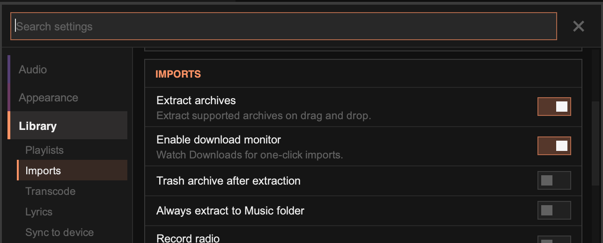

import { Image } from 'astro:assets';
import downloadButtonImg from '../../../assets/download-button.png';

Tauon can watch your Downloads folder and let you import new music with one click. This works well with music bought from stores like Bandcamp.

<Image src={downloadButtonImg} alt="The download import button in the top panel" width={200} densities={[1, 2]} />

## How it works

When a new album folder or music archive appears in your Downloads folder, a download button with a count appears at the right of the top panel. Click it to import everything that's ready. Archives are extracted first.

Right-click the button and choose **Dismiss** to ignore the current downloads.

:::note
Only recent downloads are picked up: folders from the last hour and archives from the last four hours. Tauon waits until an archive has finished downloading.
:::

## Setup

Go to **Settings › Library › Imports** and turn on:

1. **Extract archives**, which extracts supported archives when you import or drag them into Tauon
2. **Enable download monitor**, which watches your Downloads folder



Optional:

- **Trash archive after extraction** moves the archive to the trash once it's extracted.
- **Always extract to Music folder** extracts into your Music folder instead of next to the archive.

## Which playlist?

New downloads are imported into:

1. the playlist you've marked as the downloads playlist (right-click its tab, then **Misc… › Set as Downloads Playlist**), or
2. a playlist called "Downloads", or
3. the playlist you're viewing.

## Archive formats

- **ZIP** works out of the box.
- **RAR** needs the `unrar` program installed.
- **7z** needs the `7z` program installed (usually from the `p7zip` or `7zip` package).

**Arch Linux**

```bash
sudo pacman -S unrar 7zip
```

**Flatpak**

Install the programs on your system, then allow the Flatpak to run them:

```bash
sudo apt install unrar p7zip-full  # Ubuntu/Debian
sudo dnf install unrar p7zip        # Fedora
sudo flatpak override com.github.taiko2k.tauonmb --talk-name=org.freedesktop.Flatpak
```
