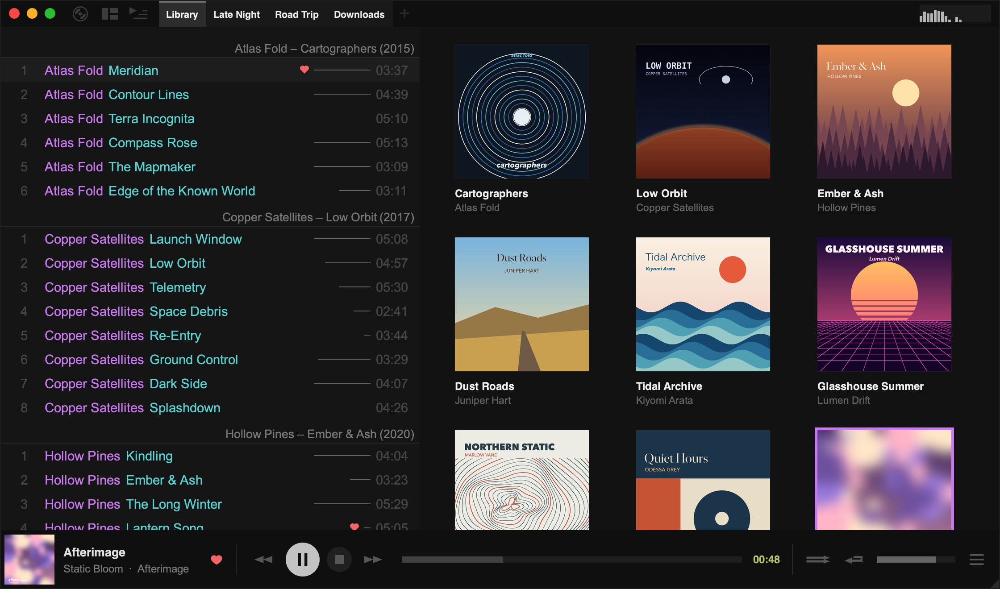

The gallery shows the albums in the current playlist as a grid of cover art.

## Open the gallery

- Click the layout button (the second button in the top-left corner) and choose **Tracks + Gallery**.
- Or press `]` / `[` (or your mouse's back and forward buttons) to cycle through layouts until you reach it.
- Press `Tab` to open the gallery in keyboard control mode (see below).

Drag the border between the tracklist and the gallery to resize the gallery.

## Using the gallery

- **Click** an album to play it. To use double-click instead, turn off **Single click to play** (see below).
- **Right-click** an album to open its folder, show it in the playlist, change its cover image, add it to the [queue](/manual/queue/), or [transcode](/manual/transcoding/) it.
- **Right-click empty space** in the gallery to change how it looks:
  - **Thumbnail size**
  - **Show titles** and **Center title text**
  - **Single click to play**
  - **Scroll by row**
  - **Combine multi-discs** shows multi-disc albums as one cover

:::tip
If a thumbnail shows the wrong image, right-click it and choose **Image… › Next** to pick another image from the album's folder.
:::

## Keyboard control mode

Press `Tab` to open the gallery with keyboard control:

- Arrow keys move between albums
- `Enter` plays the selected album
- `Tab` again returns to where you were

If you're already in the gallery layout, `Tab` switches keyboard control on and off.

## Gallery widgets

[Custom layouts](/manual/layouts/#custom-layouts) have more gallery styles: **Gallery: Compact** (a fixed number of albums per row) and **Albumflow** (a scrolling row of covers).
