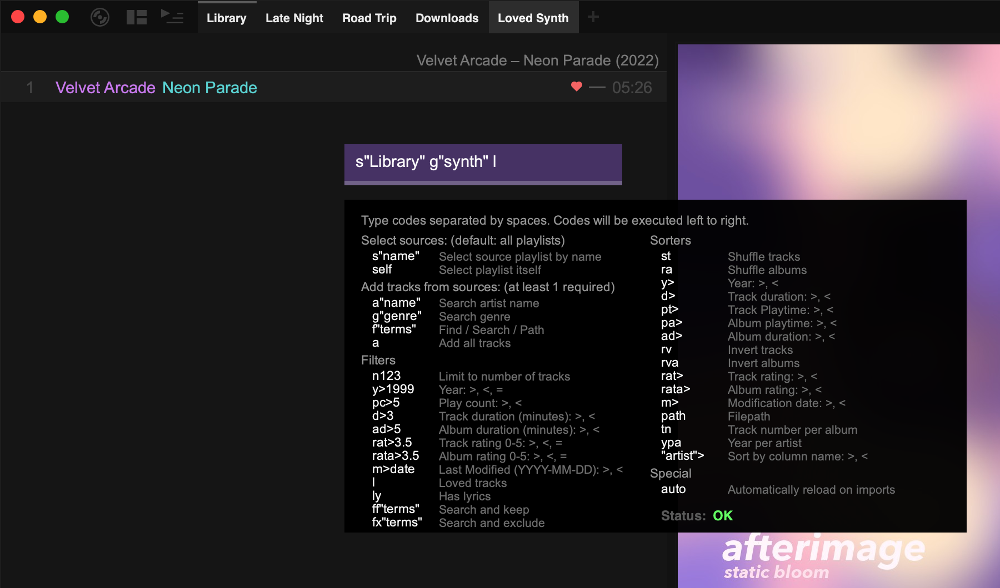

import { Image } from 'astro:assets';
import generateMenuImg from '../../../assets/generate-menu.png';

Smart playlists (also called generator playlists) are built from other playlists using a short code. They're the main way to make a filtered or sorted view of your library.

:::tip[Recommended workflow]
Import your whole library into one **source playlist**. Then create and delete smart playlists from it as you like.
:::

## Use a preset

The quickest way to create a smart playlist:

1. Right-click a playlist tab.
2. Choose **Generate…**.
3. Pick a preset, such as **Top Played Tracks**, **Shuffled Albums**, **Loved** or **Has Lyrics**.

<Image src={generateMenuImg} alt="The Generate menu" width={350} densities={[1, 2]} />

The new playlist is generated from the playlist you right-clicked.

Smart playlists are also created when you click an artist, genre or folder in [global search](/manual/search/), or press `Shift` + `Enter` in quick find.

## Regenerate

To update a smart playlist with changes from its source, right-click its tab and choose **Regenerate** (`Alt` + `R`).

To have playlists update automatically whenever you switch to them, turn on **Settings › Library › Playlists › Auto reload playlists**. This skips playlists that shuffle, playlists from network servers, and the playlist that's currently playing. To make a particular playlist always update, add the code `auto` to it.

## Write your own

Right-click a tab and choose **Edit Generator…** (or press `Ctrl` + `E`). To start a new smart playlist, press `Ctrl` + `Shift` + `E`.

Type codes in the box. The playlist updates as you type, and the editor shows a quick reference and whether your code worked.

### How codes work

There are four kinds of code: **selectors**, **searches**, **filters** and **sorters**. You need at least one search. Codes run in order, so typically you:

1. Select which playlists to use (optional; otherwise all playlists are used)
2. Search, or add every track with `a`
3. Filter and sort (optional)

For example:

| You want | Code |
| --- | --- |
| All your loved tracks | `a l` |
| Loved tracks from one playlist | `s"My Playlist" a l` |
| Loved tracks by one artist | `a"Artist Name" l` |
| 10 random tracks from "Library" | `s"Library" a st n10` |
| Every album, shuffled | `a sf` |
| Unplayed tracks by an artist | `s"Library" a"Coldplay" pc<1` |

### Selectors

| Code | Example | Notes |
| --- | :---: | --- |
| Use a playlist | `s"Library"` | Add several to use several playlists. Without any, all playlists are used. |
| Clear selection | `clr` | Goes back to using all playlists |
| This playlist | `self` | Uses the playlist itself as the source. Combine with `auto` and a sorter to re-sort tracks as they're imported. Filters with this are destructive. |
| Exclude a playlist | `px"Archive"` | Leaves out any track that is in that playlist |

### Searches

| Code | Example | Notes |
| --- | :---: | --- |
| All tracks | `a` | Use this if you don't search for anything |
| Artist | `a"Artist Name"` | Partial matches work, like `a"arti"` |
| Genre | `g"Rock"` | Partial match. Use `g="Rock"` for an exact genre. Combine several, like `g"k-pop" g"j-pop"`. |
| Label | `lb"Warp"` | Partial match. Use `lb="Warp Records"` for an exact label. |
| Folder | `p"Albums/Live"` | Matches part of the folder path |
| Find anything | `f"text"` | Like quick find: title, artist, album, composer, comment and file path |
| Find exact text | `fs"text"` | Like `f`, but matches the exact text including spaces |
| File type | `ext"flac"` | Matches the file extension |

### Filters

| Code | Example | Notes |
| --- | :---: | --- |
| Limit | `n50` | Keep at most 50 tracks |
| Year | `y>2015`, `y<2000`, `y=2016` | Also `y>=` and `y<=` |
| Play count | `pc>5`, `pc<1` | |
| Playtime | `pt>600` | Total time played, in seconds |
| Track length | `d<3`, `d>10` | In **minutes** |
| Album length | `ad>40` | In minutes |
| Rating | `rat>3`, `rat<4.5`, `rat=5` | In stars. `rat` keeps only rated tracks and `norat` only unrated tracks. |
| Album rating | `rata>4` | Also `rata<` and `rata=` |
| Loved | `l` | |
| Has lyrics | `ly` | |
| Part of a CUE sheet | `cue` | |
| Released on this day | `today` | Tracks whose release date matches today's month and day |
| Comment | `com"bandcamp"` | Exact text in the comment |
| Modified date | `m>2024-01-01` | Also `m<` |
| Keep matches | `ff"text"` | Like `f`, but only keeps tracks already added |
| Remove matches | `fx"text"` | Removes tracks that match |

### Sorters

| Code | What it sorts by |
| --- | --- |
| `st` | Shuffle tracks |
| `sf` | Shuffle albums |
| `y<` / `y>` | Year, oldest first / newest first |
| `pt>` / `pt<` | Most / least played tracks |
| `pa>` / `pa<` | Most / least played albums |
| `d>` / `d<` | Longest / shortest tracks |
| `ad>` / `ad<` | Longest / shortest albums |
| `rat>` / `rat<` | Highest / lowest rated tracks |
| `rata>` | Highest rated albums |
| `m>` / `m<` | Most / least recently modified files |
| `ia>` / `ia<` | Most / least recently imported folders |
| `rv` / `rva` | Reverse the tracks / albums |
| `tn` | Track number within each album |
| `ypa` | Year, within each artist (artists must already be grouped) |
| `path` | File path |
| `"Bitrate">` | Any column, by its exact title in the columns view. Use `<` to reverse. |

### Special

| Code | Notes |
| --- | --- |
| `auto` | Regenerate this playlist every time you switch to it |

Codes for network sources, such as `jelly` and `plex`, are covered in [Network Sources](/manual/network-sources/) and [Jellyfin](/manual/jellyfin/).

:::note
If you rename a playlist that a code refers to, update the code by hand. If several playlists share a name, the first one is used.
:::

:::caution
Keep your source playlists before any smart playlists in your tab order. For example, keep your main library playlist first.
:::
