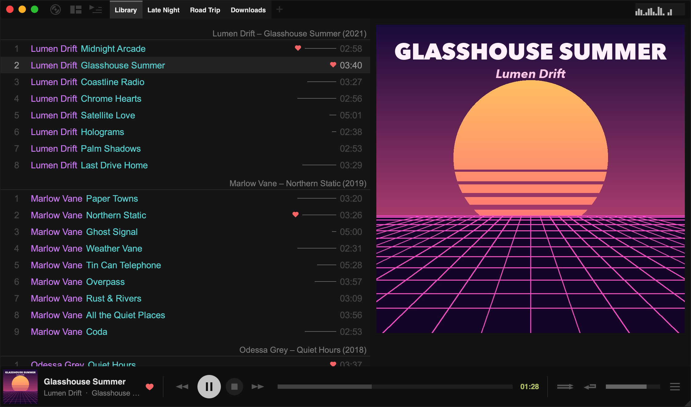
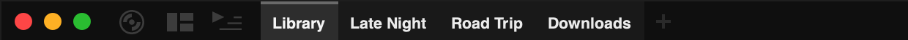
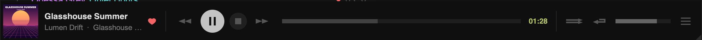

import { Image } from 'astro:assets';
import sidePanelImg from '../../../assets/side-panel.png';
import leftPanelImg from '../../../assets/left-panel.png';

## The top panel

The three buttons in the top-left corner are:

| Button | Click | Right-click |
| --- | --- | --- |
| **Main menu** (record icon) | Opens the main menu: new playlists, Settings, the Database… tools and more | Same as click |
| **Layout** | Opens the [layout menu](/manual/layouts/) to switch between views | — |
| **Side panel** | Shows or hides the left panel | Chooses what the left panel shows |

Middle-clicking the side-panel button switches back to the left panel view you used before.

Right-clicking empty space in the top panel opens a small menu where you can hide the playlist tabs and turn on a **Level Meter** or **Spectrum Visualizer** at the top right.

### Playlist tabs

Click a tab to view that playlist. You can also scroll the mouse wheel over the tabs to move between them.

:::note
Viewing a different playlist doesn't interrupt playback. Tauon keeps playing from the playlist where playback started.
:::

- **New playlist:** choose **New Playlist** from the main menu, press `Ctrl` + `T`, or click the **+** after the last tab.
- **Play:** double-click the tab to start playing the selected track in that playlist.
- **Rename:** right-click the tab and choose **Rename**, or press `F2`.
- **Delete:** middle-click the tab, or right-click it and choose **Delete**. Press `Ctrl` + `Z` to undo.
- **Add tracks:** drag tracks from the tracklist onto a tab.
- **New playlist from tracks:** drag tracks to the empty space after the last tab.
- **Reorder:** drag tabs left and right.
- **Merge:** hold `Shift` while dragging a tab onto another.
- **Duplicate:** hold `Ctrl` while dragging a tab to the empty space after the last tab.

Right-click a tab for more options, such as sorting, smart playlist presets, and export. To keep a playlist out of the top panel, choose **Unpin**. It stays available in the left panel's playlist list. To group playlists, see [Playlist Folders](/manual/playlist-folders/).

## The bottom panel

From left to right:

- **Now playing:** the album art, title, artist and album of the current track. The heart loves the track.
- **Playback buttons:** back, play/pause, stop and forward.
- **Seek bar:** click or drag to jump to a position. Middle-click it to show a time cursor.
- **Shuffle** and **repeat** toggles. Right-click them for more modes (see below).
- **Volume:** drag, or scroll the mouse wheel over the panel.
- **Playback menu** (☰): Audio Info, mini modes, random track, playback speed and other quick actions.

Right-click empty space in the bottom panel to choose a [mini mode](/manual/mini-mode/), switch to the more compact classic panel, or copy the playing track's title.

### Shuffle and repeat modes

Right-click the **shuffle** button for:

- **Shuffle Tracks** and **Random Albums**
- **Shuffle Lockdown**: a distraction-free view that plays your playlist in shuffle with the playback controls hidden. Press `Esc` or choose **Exit Shuffle Lockdown** from the main menu to leave.

Right-click the **repeat** button for:

- **Repeat Track** and **Repeat Album**
- **A/B Repeat**: select it once to set the start point, again to set the end point, and a third time to clear. The section between the markers loops.

:::tip[Album shuffle]
To shuffle within a single album, turn on both **Repeat Album** and shuffle.
:::

Right-click the **stop** button to stop after the current track or album, either once or every time.

## The side panel

<Image src={sidePanelImg} alt="The side panel with album art and track details" width={302} densities={[1, 2]} />

The side panel on the right shows the playing track's album art and details. Drag its left edge to resize it. When it's wide enough, the art fills the panel, as in the screenshot at the top of this page.

- **Click** the art to cycle through other images in the album's folder.
- **Right-click** the art for image tools (open, extract, fetch cover art), lyrics, the centered style, **Zoom Art to Fit**, and the [MilkDrop visualiser](/manual/milkdrop/).
- **Right-click** the track details for [lyrics](/manual/lyrics/) options.
- Hold `Shift` while dragging the edge to make the panel wider than the art is tall.

## The left panel

Click the side-panel button in the top-left corner to show the left panel. Right-click the button to choose what it shows:

- **Playlists + Queue:** your playlists and folders, with the [queue](/manual/queue/) below
- **Queue:** only the queue
- **[Artist List](/manual/artist-list/):** the artists in the current playlist
- **[Folder Navigator](/manual/folder-navigator/):** the current playlist's folders as a tree

<Image src={leftPanelImg} alt="The left panel showing playlists and the queue" width={450} densities={[1, 2]} />

## The tracklist

The tracklist shows the playlist you're viewing, grouped into albums under a heading.

### Selecting tracks

- **One track:** click it.
- **A whole album:** click the album heading.
- **A range:** click the first track, then `Shift`-click the last.
- **Everything:** press `Ctrl` + `A`.

### Moving and copying tracks

- Drag selected tracks to move them, or onto a playlist tab to add them there.
- To move a single track within an album, hold `Shift` while dragging it.
- Copy, cut and paste with `Ctrl` + `C`, `Ctrl` + `X` and `Ctrl` + `V`. Pasting with the keyboard adds tracks to the end of the playlist. **Paste** in the right-click menu adds them after the album you clicked.
- Press `Delete` to remove the selection from the playlist. This doesn't delete any files.

### Customising the tracklist

Right-click a track and open the **Layout** submenu to change the tracklist's look: show or hide loves, ratings and playcount lines, change the font size and row height, or switch on columns.

### Scrolling

Scroll with the mouse wheel or trackpad. A scroll bar appears when you hover near the right edge of the tracklist:

- Drag the grip, or hold the mouse button above or below it to scroll quickly.
- Right-click the scroll bar to jump straight to that position.
