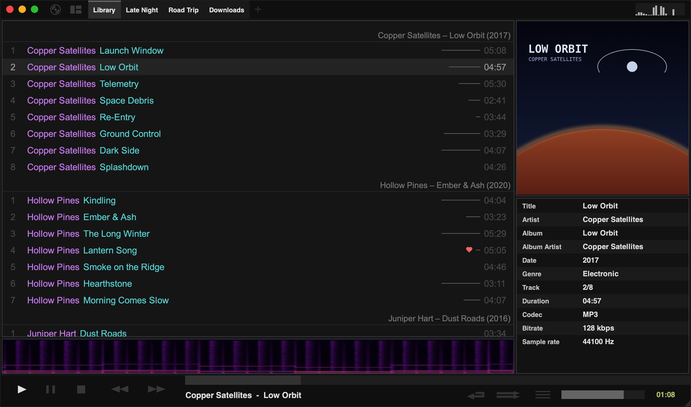
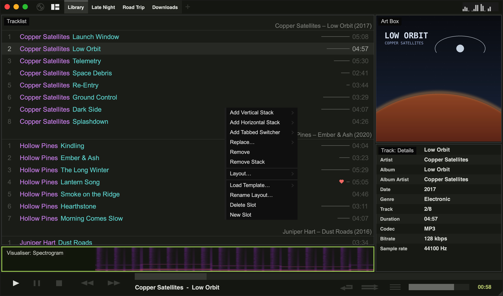

import { Image } from 'astro:assets';
import layoutMenuImg from '../../../assets/layout-menu.png';

Tauon has several ready-made layouts and lets you design your own. Click the **layout button** (the second button in the top-left corner) to choose one:

<Image src={layoutMenuImg} alt="The layout menu" width={350} densities={[1, 2]} />

| Layout | What it shows |
| --- | --- |
| **Tracks + Art** | The tracklist with album art and track details on the right. This is the default. |
| **Tracks + Art (Reversed)** | The same, with the art on the left |
| **Tracks + Gallery** | The tracklist beside an album [gallery](/manual/gallery/) |
| **Tracks** | Only the tracklist |
| **Art + Lyrics** | Large album art beside the [lyrics](/manual/lyrics/) of the playing track |
| **Radio** | The [internet radio](/manual/radio/) view |

Below those are your **custom layouts**.

To cycle through layouts without the menu, press `]` and `[`, or use the back and forward buttons on your mouse. `F5` jumps to **Art + Lyrics** and back.

You can change the order of the layouts, which also sets the cycling order, under **Settings › Appearance › Layouts**.

## Custom layouts

Custom layouts let you arrange the window however you like from building blocks called **widgets**. Tauon comes with two examples, **Volcano** and **Tracks + Gallery (Compact)**, plus an empty slot to start from.

### Edit a layout

1. Choose a custom layout from the layout menu.
2. Open the layout menu again and choose **Enter Edit Mode**.
3. Right-click any area of the layout to change it:
   - **Add Vertical Stack** / **Add Horizontal Stack** splits the area into 2 to 5 parts.
   - **Add Tabbed Switcher** makes the area a set of tabs, each holding its own content.
   - **Add…** places a widget in an empty area. **Replace…** swaps an existing one.
   - **Remove** and **Remove Stack** take things away again.
   - **Layout…** has options to lock an area's size, keep it square, and adjust the gutter, padding and border.
4. Drag the borders between areas to resize them.
5. Click the layout button or press `Esc` to leave edit mode.

The same right-click menu also has **Load Template…** to start over from a template, **Rename Layout…**, and **New Slot** / **Delete Slot** to manage your layouts.

:::tip
Mark a stack as **Make Stack Resizable** (in the **Layout…** submenu) if you want to drag its borders while you're using the layout, not just in edit mode.
:::

### Widgets

| Group | Widgets |
| --- | --- |
| Music | Tracklist, Gallery: Classic, Gallery: Compact, Albumflow, Art Box, Lyrics Box, Artist Info |
| Track info | Track: Titles, Track: Titles (Centred), Track: Details |
| Side panels | Playlist List, Folder Navigator, Artist List, Queue |
| Visualisers | Visualiser: Milkdrop, Visualiser: Bars, Visualiser: Spectrogram |
| Panels | Header Bar, Playback Panel, Playback panel: Feux |

Most widgets can only be used once per layout. Widgets that are already in use are greyed out in the **Add…** menu.

Many widgets have their own right-click menu. For example, right-click the compact gallery to change the number of albums per row, or right-click Albumflow to choose how covers are displayed.

Custom layouts are saved in `custom_layouts.json` in Tauon's [data folder](/manual/app-data/).
