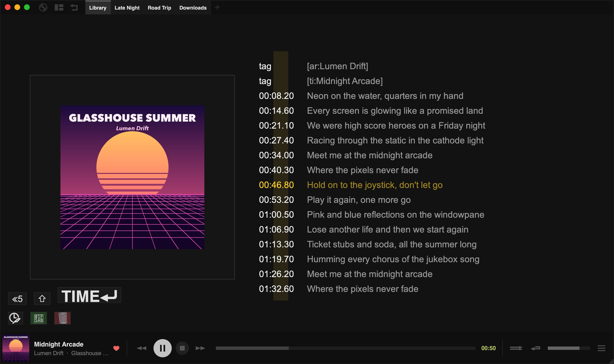
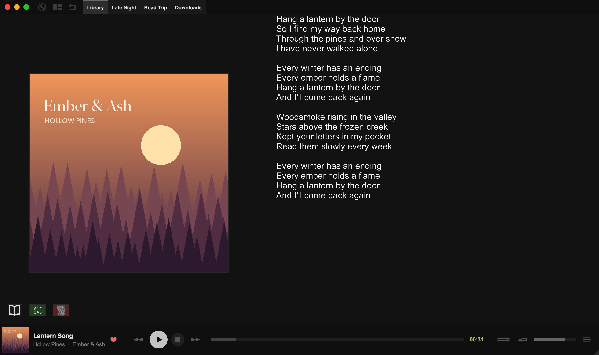

The lyrics editor lets you write lyrics, sync them to the music line by line, and save them to your files or upload them to LRCLIB.

To open it, right-click the lyrics (or the track details in the side panel) and choose **Lyrics Editor**. Tauon switches to the **Art + Lyrics** layout with the editor open for the playing track. To leave, right-click and choose **Exit Lyrics Editor**.

The editor has two views, for the two kinds of lyrics Tauon stores for every track:

- The **synced view** works line by line, with a timestamp for each line. Most of this page is about this view.
- The **unsynced view** is a plain text editor.

Switch between them with the button at the bottom left, under the album art.

On macOS, read `Ctrl` as `Cmd` and `Alt` as `Option`.

## The synced view

The album art is on the left, with the editor's buttons below it. On the right are a column of timestamps and a column of lyrics.

Tauon saves synced lyrics in the standard LRC format.

### Editing text

Click a line to start editing it. Use the normal text keys (`Enter`, `Backspace`, `Delete` and the arrow keys) to move between lines. Press `Esc` to stop editing.

- To delete a line, click the **×** to its right.
- To add a line, click **+**.

Hold `Alt` while clicking these buttons to see what else they can do.

You can paste text with several lines, even text that already has timestamps. Hold `Alt` while pasting to overwrite the following lines instead of inserting new ones.

### Syncing

Play the track. Each time a new line starts, click the **TIME** button (or press `Enter`). This stamps the current time on the next line and moves on. That's all you really need: if you don't make mistakes, you can sync a whole song in one go.

If you do make a mistake:

- **≪5** seeks back 5 seconds.
- **⇧** goes back to the previous line you timed and removes the faulty timestamp.
- Right-click **TIME**, or press `Backspace`, to do whichever of the two goes back less far.

Hold `Alt` while using any of these to seek back without removing timestamps.

While playing, press `Alt` + `Up` / `Down` to jump between lines that are already timed.

Modifiers for **TIME** (its label changes to show the mode):

- Hold `Alt` to time the current line instead of the next one.
- Hold `Ctrl` to create a new timed line right after the current one, and fill in the text later.

While playing, `Delete` removes the upcoming line and `Alt` + `Delete` removes the current one.

### Timestamps

Timestamps are shown to the left of each line. Click a timestamp to jump to that point in the song, or click the **×** to its left to delete it.

- `tag` means the line holds information about the track in LRC format, rather than lyrics.
- `??:??.??` means the line hasn't been timed yet.

To fine-tune a timestamp, hover over it and hold `Alt`, then scroll or use the `Left` and `Right` keys. Hold `Ctrl` as well for smaller steps. Tauon jumps to the new time so you can hear whether it's right.

:::tip
If lyrics consistently show up too early or too late on your system, adjust `synced-lyrics-time-offset` in the config file (**Settings › System › Files › Open config file**).
:::

## The unsynced view

The unsynced view is a simple text editor for plain lyrics. Type or paste the lyrics, then save.

Right-click for **Search for Lyrics**, **Copy From Synced** and **Upload To LRCLIB**.

## Saving

Click the green save button, or press `Ctrl` + `S`. The first time, a dialog asks where to save:

- whether to also write the lyrics into your audio files' tags, and
- whether synced lyrics go into the file's tags or a separate `.lrc` file next to it.

Turn off **Show this every time** to save straight away in future. You can bring the dialog back with `Ctrl` + `Shift` + `S`. The same options are in **Settings › Library › Lyrics**.

Click the red button to discard your changes and go back to the last saved lyrics.

:::caution
Synced and unsynced lines can't be mixed. When you save, every line except tags should either have a timestamp or have none. If none of the lines are timed, the lyrics are saved as unsynced lyrics. Tauon warns you if they're mixed.
:::

### Saving at the end of the track

Right-click and open **When track ends…** to choose what happens when the song finishes while the editor is open:

- **Repeat track**, to try again
- **Stop immediately**
- **Backup and continue**
- **Fully save and continue**, so you can sync a whole album by just letting it play

This only applies while the editor is open.

### Backups

Tauon automatically keeps a backup of your work on the synced lyrics for each track. Backups aren't shown in the player or saved to your files. They're for recovering from mistakes, like closing without saving or clearing the lyrics by accident. Right-click and choose **Backups… › Load Current Backup** to get your work back.

## Other tools

The right-click menu also has:

- **Search for Lyrics**
- **Copy From Unsynced**, to start syncing from existing plain lyrics
- **Clear All Section Markers** (removes lines like `[Chorus]`), **Clear All Timestamps** and **Clear All Lyrics**

## Uploading to LRCLIB

If you're happy with your lyrics, share them on [LRCLIB](https://lrclib.net), a free online lyrics database. Right-click and choose **Upload To LRCLIB**, then pick whether to include the synced and unsynced versions.

Uploading can take a while. LRCLIB asks for a small proof-of-work calculation before accepting uploads, which can take about 20 seconds.
