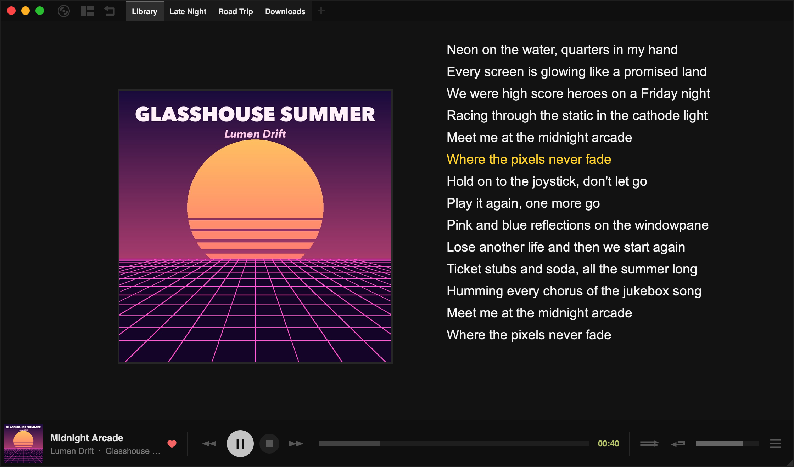

Tauon shows lyrics in two places:

- The **side panel**, in place of the track details
- The **Art + Lyrics** layout (press `F5`, or choose it from the [layout menu](/manual/layouts/))



Right-click the lyrics, or the track details in the side panel, for the lyrics menu.

Tauon handles two kinds of lyrics:

- **Unsynced lyrics** are plain text.
- **Synced lyrics** have a timestamp on each line. The current line is highlighted and the lyrics scroll along with the song. You can create and fix them in the [Synced Lyrics Editor](/manual/lyrics-editor/).

## Where lyrics come from

- **Your files:** lyrics in the track's tags are read when you import. A `.lrc` file with the same name as the audio file, in the same folder, is picked up as synced lyrics. For example, `clocks.mp3` and `clocks.lrc`.
- **The internet:** choose **Search for Lyrics** from the lyrics menu. Turn on **Auto-search lyrics** in **Settings › Library › Lyrics** to search automatically. The same section lets you choose which lyrics sources to use.
- **Your clipboard:** choose **Misc… › Paste Lyrics**.
- **Network servers:** Jellyfin and Subsonic servers can provide lyrics too.

To re-read lyrics from your files, right-click the track and choose **Meta… › Rescan Tags**.

## The lyrics menu

| Item | What it does |
| --- | --- |
| **Search for Lyrics** | Looks up lyrics online |
| **Show Lyrics** | Shows lyrics in the side panel instead of the track details whenever lyrics are available |
| **Prefer Synced Lyrics** | When a track has both kinds, shows the synced lyrics |
| **Lyrics Editor** | Opens the [Synced Lyrics Editor](/manual/lyrics-editor/) |
| **Misc…** | Substitute Search, Paste, Copy, and Clear options |

**Clear Lyrics** and **Clear Synced Lyrics** remove lyrics from Tauon's database. Whether lyrics changes are also written to your files is controlled by **Save lyrics edits to tags** in **Settings › Library › Lyrics**.

## Substitute search

If lyrics can't be found because of how a track is named, for example because of a featured artist in the title, choose **Misc… › Substitute Search…**. Enter the artist or title to search for instead, then click away to confirm.

:::caution
Substitutions apply to every track with the same artist (or title), not just the one you clicked.
:::

To remove a substitution, open **Substitute Search…** again and clear the field.

## Synced lyrics format

Synced lyrics use the LRC format. Each line starts with a timestamp in the form `[mm:ss.xx]`:

```text
[00:34.00]Meet me at the midnight arcade
[00:40.30]Where the pixels never fade
```
