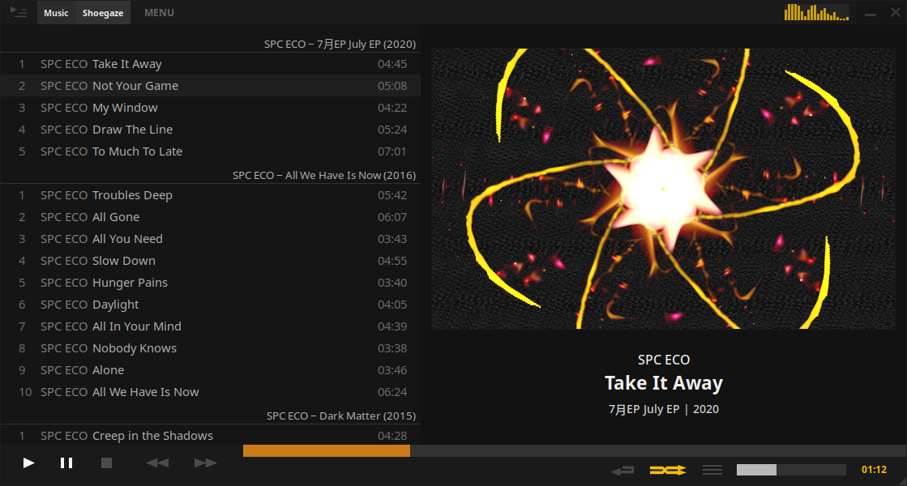

Tauon can play Winamp-style MilkDrop visualisation presets (`.milk` files), powered by [projectM](https://projectm-visualizer.org/).

To turn it on, right-click the album art in the side panel and select **MilkDrop Visualiser**. It replaces the album art while it's on.

- **Click** the visualiser to switch to a random preset.
- **Right-click** it for these options:
  - **Auto Cycle** changes preset every 30 seconds or so.
  - **Cut Out** makes dark areas transparent, so the album art shows through.
  - **Favorite This Preset** marks the current preset as a favourite.
  - **Choose Preset** opens a full-window picker. Type to filter presets, and click the star to show only favourites.
  - **Enable Wide Mode** stretches the visualiser across the **Art + Lyrics** layout.
  - **Open Preset Folder** opens the folder where presets are stored.

The visualiser is also available as a widget in [custom layouts](/manual/layouts/#custom-layouts).

## Presets

If you have no presets when you turn the visualiser on, Tauon offers to download a small curated preset pack (about 5 MB).

To add your own, put `.milk` files in the preset folder (use **Open Preset Folder**), or drag and drop a `.milk` file onto Tauon to load it straight away. Presets must be in the MilkDrop v1 `.milk` format.

There are many presets online, but compatibility isn't perfect. Some may show glitches or display only a black or white screen.

:::note
If the **MilkDrop Visualiser** option is missing, your build of Tauon doesn't include projectM or OpenGL support.
:::
