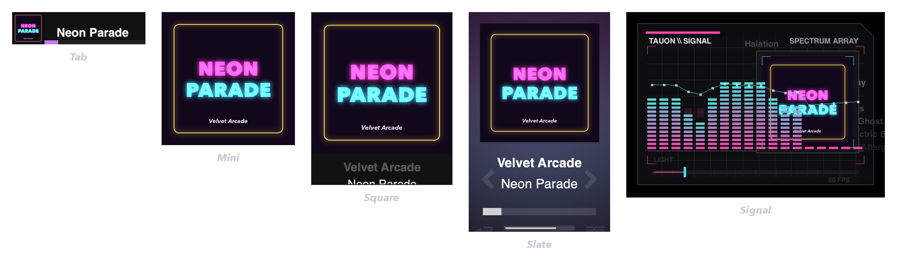

Mini mode shrinks Tauon to a small player window. There are several styles:

| Style | Description |
| --- | --- |
| **Tab** | A slim bar with a small cover, the track title and progress |
| **Mini** | Just the album art |
| **Square** / **Square Large** | The album art with the artist and title below |
| **Slate** | Art, artist and title, with skip arrows and a seek bar |
| **Signal** | A retro spectrum display with the album art |

## Enter mini mode

- Press `F8`.
- Open the playback menu (☰ at the right of the bottom panel) and choose a style from **Mini Mode**.
- Right-click empty space in the bottom panel and choose a style.

## Using mini mode

- The usual playback controls are available, depending on the style.
- **Right-click** to play or pause.
- **Middle-click** (or `Shift`-click) switches between **Tab** and **Square**.

To keep the mini player above other windows, turn on **Mini-mode always on top** in **Settings › Appearance › Window**.

## Return to the full window

Press `F8` again, or double-click the title area of the mini player.
