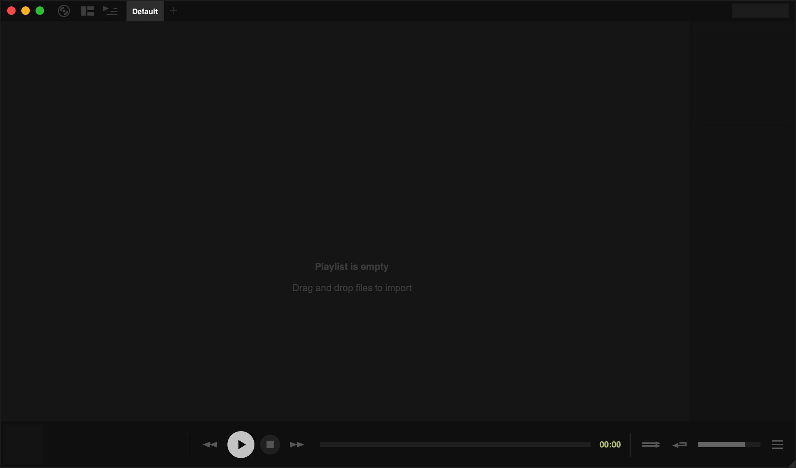

Tauon is a playlist-oriented music player that assumes folders are albums. You'll see the words "album" and "folder" used interchangeably in the interface and in these docs.

Some features aren't obvious at first, and many live in right-click menus, so it's worth right-clicking things as you explore. Once you know your way around, Tauon is fast and fun to use.

## First launch

When you start Tauon for the first time you get an empty window:

| Area | What it's for |
| --- | --- |
| **Top panel** | The main menu, layout and side-panel buttons in the corner, then your playlist tabs |
| **Tracklist** | The tracks in the playlist you're viewing |
| **Side panel** | Album art and track details for the playing track (it appears once you've added music) |
| **Bottom panel** | Playback controls, the seek bar and volume |

See [Main Window](/manual/interface/) for a tour of each area.

## Import your music

Drag and drop files or folders from your file manager into the tracklist.

Alternatively, open the main menu (the record icon in the top-left corner) and choose **Import Music Folder**. This creates a playlist called "Music" and imports your system Music folder into it.

:::tip
To get started, import your whole collection into a single playlist. You can then build smaller playlists from it using [search](/manual/search/), drag and drop, or [smart playlists](/manual/generators/).
:::

Tauon works best when every album is in its own folder and your files are properly tagged.

### Keeping your library up to date

Tauon doesn't watch your folders in the background. When you've added new music, either:

- right-click the playlist tab and choose **Rescan Folder** to re-import the folders that playlist was built from, or
- choose **Database… › Reload All Folders** from the main menu to rescan every playlist's folders.

## Play music

- **Double-click** a track to play it.
- Use the play, pause, stop, back and forward buttons in the bottom panel.
- Click or drag on the seek bar to jump to a position.
- Press `'` (or right-click the play button) to **go to playing**, which scrolls the tracklist to the current track.

## Essential shortcuts

| Shortcut | Action |
| --- | --- |
| `Space` | Play/pause |
| `-` / `=` | Seek backward/forward |
| `Left` / `Right` | Switch playlists |
| `Shift` + `Left` / `Right` | Previous/next track |
| `'` | Show the playing track |
| `,` / `.` | Toggle repeat / shuffle |
| `Ctrl` + `F` | Find in the current playlist |
| Start typing | Search all playlists |

For the complete list, see [Keyboard Shortcuts](/manual/keyboard-shortcuts/).

## Where are the settings?

Open the main menu and choose **Settings**. The settings window has a search box, so you can type what you're looking for and jump straight to it. Many display options live in right-click menus close to what they change. See [Settings](/manual/settings/).
