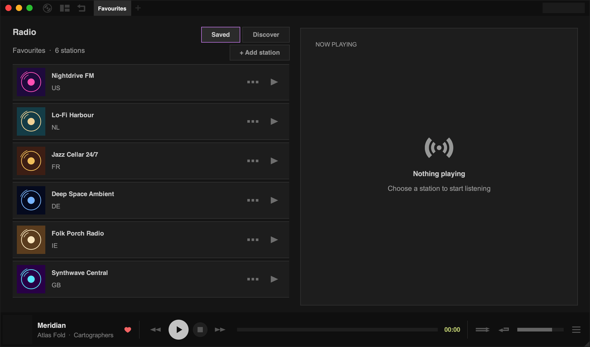

Tauon can play internet radio streams. Click the layout button (the second button in the top-left corner) and choose **Radio**.

## Find stations

Click **Discover** to browse the [Radio Browser](https://www.radio-browser.info/) directory:

- Type a station name or genre in the search box and click **Search**.
- Use the **Country Filter** to narrow results to a country.
- **Picks** shows featured stations and **Top** shows the most popular ones.

Click a station to play it, or **Save** to add it to your saved stations.

## Saved stations

**Saved** shows your saved stations. Radio stations are kept in their own lists, shown as tabs in the top panel while you're in the radio view. Choose **New Radio List** from the main menu to make another list.

To add a station that isn't in the directory, click **+ Add station** and enter its name and stream URL. You can drop an image onto the dialog to use as the station's picture.

Right-click a saved station for **Edit…**, **Visit Website** and **Remove**.

## Recording

Tauon can record radio as you listen, splitting the stream into separate tracks where the station provides track titles. Turn on **Settings › Library › Imports › Record radio**, then restart playback.

Recorded tracks are added to a playlist called **Saved Radio Tracks**. Press `F9` to open the folder they're saved in.
