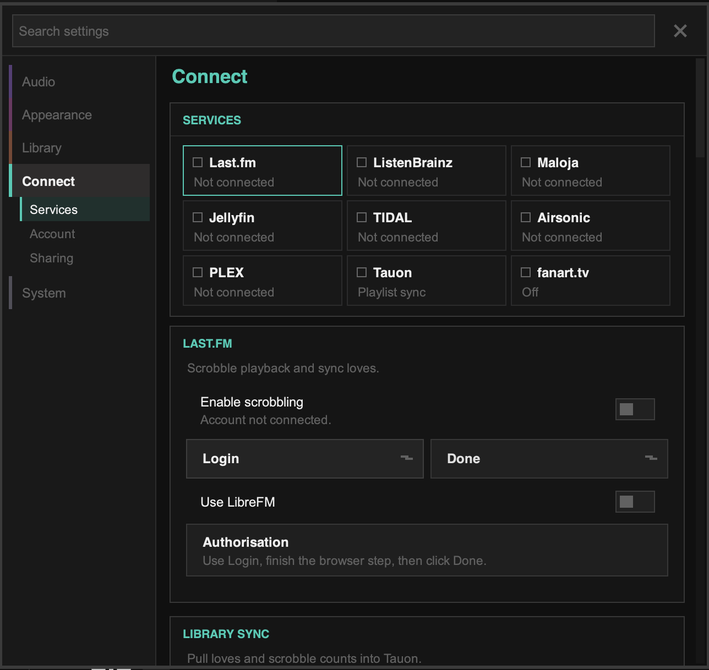

import { Steps } from '@astrojs/starlight/components';

Tauon can record what you listen to ("scrobble") to **Last.fm**, **Libre.fm**, **ListenBrainz** and self-hosted **Maloja** servers.

Set these up in **Settings › Connect**. Each service has a tile showing whether it's connected. Click a tile to open its settings below.

## Last.fm

<Steps>
1. Click the **Last.fm** tile, then **Login**. Your web browser opens.
2. Sign in to Last.fm and allow access for Tauon.
3. Return to Tauon and click **Done**.
4. Make sure **Enable scrobbling** is on.
</Steps>

To use **Libre.fm** instead, turn on **Use LibreFM** before you log in.

Once you're logged in, you can also:

- **Get user loves** to copy your loved tracks from Last.fm into Tauon
- **Get friend loves** to see which tracks your friends love
- **Get scrobble counts** to show your Last.fm play counts in Tauon
- Turn on **Pull love on scrobble/rescan** to keep loves in sync. This replaces Tauon's love status with Last.fm's.
- Turn on **Show threshold marker** to mark the point on the seek bar where a track counts as scrobbled.

## ListenBrainz

<Steps>
1. Copy your user token from your [ListenBrainz settings page](https://listenbrainz.org/settings/).
2. In Tauon, click the **ListenBrainz** tile, then **Paste token**.
3. Turn on **Enable scrobbling**.
</Steps>

## Maloja

<Steps>
1. Click the **Maloja** tile.
2. Enter your **Server URL** and **API key**.
3. Click **Test connectivity** to check the details.
4. Turn on **Enable scrobbling**.
</Steps>

## Pausing scrobbling

While a scrobbling service is active, the main menu has an item showing **Scrobbling is Active**. Click it to pause scrobbling temporarily, for example while someone else is using your computer. Click it again to resume.

## Radio and network servers

- Each service has a **Scrobble Radios** switch for internet radio.
- Media servers such as Jellyfin, Plex and Subsonic can scrobble on their own. To avoid double scrobbles, turn off **Allow local scrobbling** in that server's settings in Tauon (or turn off scrobbling on the server).
