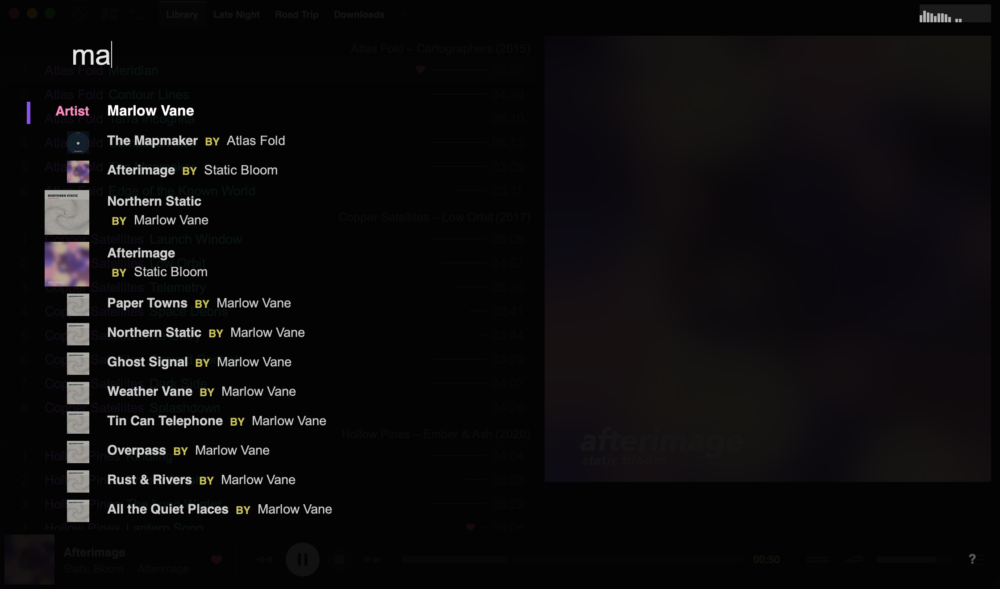

import { Steps } from '@astrojs/starlight/components';

Tauon has two ways to find music: **global search** across all your playlists, and **quick find** within the playlist you're viewing.

## Global search

Just start typing a name, or press <kbd>Ctrl</kbd> + <kbd>G</kbd>. Results update as you type.

Results are grouped by type: playlists, artists, albums, tracks, genres, folders, composers, years and labels. Tracks whose lyrics match also appear.

### Using results

| Action | Result |
| --- | --- |
| Click, or <kbd>Enter</kbd> | Albums and tracks play. Artists, genres, folders, composers, years and labels open as a new playlist. Playlists are switched to. |
| Right-click, or <kbd>Shift</kbd> + <kbd>Enter</kbd> | Shows the result in its playlist without playing it |
| <kbd>Ctrl</kbd> + click | Adds the result's tracks to the playlist you're viewing. Search stays open, so you can add several. |
| Middle-click | Adds an album or track to the [queue](/manual/queue/) |

Use the <kbd>Up</kbd> and <kbd>Down</kbd> keys to move through results, and <kbd>Esc</kbd> to close search.

### Narrowing the search

Start your search with one of these words to show only that kind of result:

| Prefix | Example |
| --- | --- |
| `artist` | `artist marlow` |
| `album` | `album static` |
| `composer` | `composer bach` |
| `label` | `label warp` |
| `year` | `year 2019` |

Search ignores accents, so `beyonce` finds "Beyoncé".

:::tip
If typing letters starts search when you don't want it to, you can turn this off in the config file (`alpha_key_activate_search`). <kbd>Ctrl</kbd> + <kbd>G</kbd> still works.
:::

## Quick find

Quick find searches only the playlist you're viewing. It matches the title, artist, album, composer, comment and file path.

<Steps>
1. Press <kbd>Ctrl</kbd> + <kbd>F</kbd> (or <kbd>\\</kbd>) to open the find box.
2. Type your search. Every word must match.
3. Use <kbd>Up</kbd> and <kbd>Down</kbd> to jump between matches, and <kbd>Enter</kbd> to play the highlighted one.
</Steps>

Press <kbd>Shift</kbd> + <kbd>Enter</kbd> to make a new playlist of all the matches.

:::tip[Advanced uses]
Because quick find searches file paths, you can:

- Find all tracks of one file type, for example `.flac`
- Find everything in a folder by part of its path

Start with `/` to match folder paths only. For example, `/live` then <kbd>Enter</kbd> makes a playlist of tracks whose folder path contains "live".
:::
