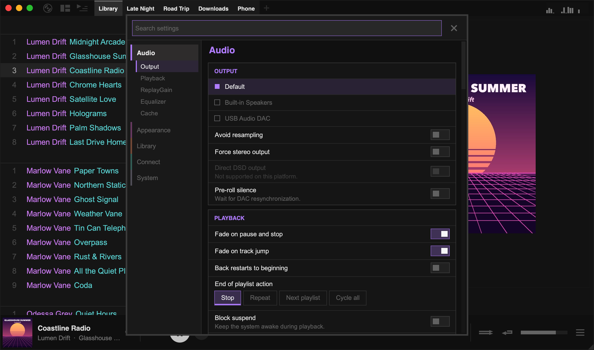

Open the main menu (the record icon in the top-left corner) and choose **Settings**.

## Search

Type in the search box at the top to find a setting by name or by what it does. For example, searching "bit perfect" finds **Avoid resampling**, and "scale" finds **Interface scale**.

Search also covers right-click menus. If an option lives in a menu rather than in Settings, the result tells you where to right-click.

## Groups

| Group | Sections |
| --- | --- |
| **Audio** | Output device and audio options, playback behaviour, ReplayGain, a 10-band equaliser, and caching for network tracks |
| **Appearance** | [Themes](/manual/themes/) and background styles, window options (including interface scale), tray icon, and [layout order](/manual/layouts/) |
| **Library** | Playlist options, [importing and archives](/manual/download-importing/), [transcoding](/manual/transcoding/), [lyrics](/manual/lyrics/), [sync to device](/manual/transcoding/#sync), library stats, and the album chart generator |
| **Connect** | [Scrobbling](/manual/scrobbling/) services, [network sources](/manual/network-sources/), and sharing ([remote control](/manual/remote-control/), Listen Along and [Discord](/manual/discord/)) |
| **System** | The data folder, config file and keymap, gamepad input, playlist export folders, and diagnostics |

## Undoing changes

When you change something, a bar at the bottom of the window lists your changes. Click **Undo all** to return everything to how it was when you opened Settings.

Some settings only take effect after a restart. These are marked while they differ from their original value, and listed in the bottom bar.

## Options in right-click menus

Many display options are kept next to the thing they change, rather than in Settings:

| Option | Where to find it |
| --- | --- |
| Gallery thumbnail size and titles | Right-click empty space in the gallery |
| Tracklist columns, font size, row height, loves and ratings | Right-click a track › **Layout** |
| Track menu search links (Wikipedia, Genius, Bandcamp, Sonemic) | Right-click a track › **Layout** |
| Playlist tabs and the top-panel visualiser | Right-click empty space in the top panel |
| Centered side panel style and **Zoom Art to Fit** | Right-click the side-panel album art |
| Showcase visualiser and wide mode | Right-click empty space in the **Art + Lyrics** view |
| Mini modes and the classic bottom panel | Right-click empty space in the bottom panel |

## Advanced settings

A few rarely used options are only in the config file. In Settings, go to **System › Files** and click **Open config file**. After editing it, click **Reload edited config** (some options still need a restart).
