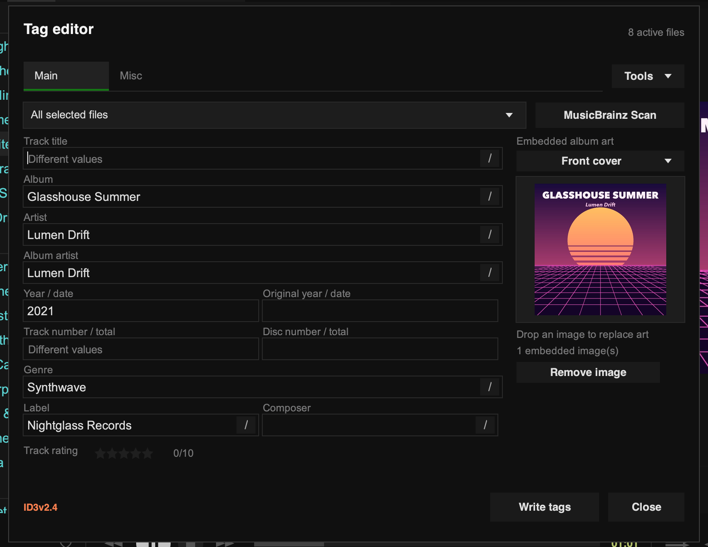

import { Steps } from '@astrojs/starlight/components';

Tauon's tag editor reads and writes the tags stored in your audio files. You can edit one track or many at once, edit embedded artwork, and look up correct tags from MusicBrainz.

## Open the editor

Select one or more tracks, right-click, and choose **Edit Tags…**. You can also right-click an album heading to edit the whole album.

The editor works with local files in the MP3, FLAC, Ogg, Opus, WavPack, APE and M4A formats. Tracks from network servers and tracks inside CUE sheets can't be edited.

## Edit tags

<Steps>
1. Change any of the fields. Edited fields get a green outline.
2. Click **Write tags** to save your changes to the files.
</Steps>

Nothing is written until you click **Write tags**. To undo a change before then, click the arrow next to the field. To throw away everything, click **Discard** (the **Close** button changes to this while you have unsaved changes) or press `Esc`.

After writing, Tauon rescans the files and updates its library. Your play counts, loves and ratings are kept.

### The Main tab

**Main** has the common fields: title, album, artist, album artist, dates, track and disc numbers, genre, label, composer, your star rating, and the embedded artwork.

When you edit several tracks at once, a field that differs between tracks shows that it has mixed values. Leave it alone to keep each track's own value, or type a new value to set it on all of them.

Use the dropdown at the top to switch between **All selected files** and a single file. Your edits are kept as you switch, and **Write tags** saves every file with changes.

Fields like artist and genre can hold several values. Click the **/** button at the end of the field to add a separator between values.

### The Misc tab

**Misc** lists every tag in the file, under the file format's own name for it. Select a row to edit it. Use **Add key** to add any tag, or **Presets** for common ones such as comment, BPM, ISRC, unsynced or synced lyrics, credits and sort order.

### Artwork

Drop an image onto the artwork area to embed it. The artwork dropdown chooses which picture to change, such as **Front cover** or **Back cover**. **Remove image** removes just that picture.

## MusicBrainz Scan

**MusicBrainz Scan** identifies your tracks by how they sound, using AcoustID audio fingerprints, and then finds matching album releases on MusicBrainz.

<Steps>
1. Select the tracks of an album and open the editor.
2. Click **MusicBrainz Scan**. Tauon fingerprints each file and looks up the results.
3. Choose the best match from the album editions listed. A table shows the proposed changes for each track.
4. Click **Use this album** to fill in the tags.
5. Check the result and click **Write tags**.
</Steps>

Fingerprints and track lengths are sent to AcoustID and MusicBrainz. Your audio files are not uploaded.

## Tools menu

- **Upgrade ID3 tags to v2.4** converts older MP3 tags to ID3v2.4, which properly supports multiple values and full dates. Some older devices only read ID3v2.3, so this is never done automatically.
- **Fix Mojibake** repairs garbled text caused by tags saved in the wrong text encoding, for example Japanese text that displays as random accented characters. Check the result before writing.
- **Automatically split slashes** treats ` / ` typed between words as a separator between values. `AC/DC` without spaces stays as one value.
