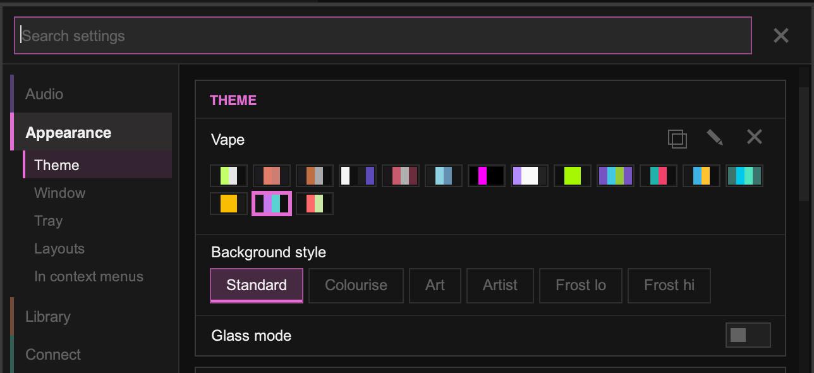

import { Steps } from '@astrojs/starlight/components';

Themes are in **Settings › Appearance › Theme**.

## Choose a theme

Click a colour swatch to switch themes. Hover over a swatch to see its name. You can also press `Ctrl` + `]` and `Ctrl` + `[` to cycle through themes.

## Background style

**Background style** changes what's behind the interface:

| Style | Description |
| --- | --- |
| **Standard** | The theme's own colours |
| **Colourise** | Tints the theme with colours from the playing album's art ("auto theme"). Press `F3` to toggle it. |
| **Art** | A blurred copy of the album art behind the interface |
| **Artist** | A picture of the playing artist behind the interface |
| **Frost lo** / **Frost hi** | A frosted-glass look over the album art, with low or high blur |

**Glass mode** makes the window translucent, so your desktop shows through (on supported desktops). **Glass intensity** and **Darken tracklist** fine-tune it.

## Make your own theme

Bundled themes can't be edited directly, so start from a copy:

<Steps>
1. Choose the theme you want to start from.
2. Click the **Duplicate** icon next to its name. This creates a copy called "*Name* Copy".
3. Click the **Edit** icon to open the theme editor.
4. Pick a colour to change and adjust it with the colour picker. Changes show live.
</Steps>

Your themes are saved as `.ttheme` files in the `theme` folder in Tauon's [data folder](/manual/app-data/). To delete one of your themes, select it and click the **Delete** icon.

## Install a theme

<Steps>
1. Open Tauon's data folder: **Settings › System › Files › Open data folder**.
2. Put the `.ttheme` file in the `theme` folder.
3. Restart Tauon, or press `Ctrl` + `]` until the theme appears.
</Steps>

Find themes made by others, or share your own, in the [custom themes discussion](https://github.com/Taiko2k/Tauon/discussions/461) on GitHub. For the theme file format, see the [Theming Guide](https://github.com/Taiko2k/Tauon/wiki/Theming).
