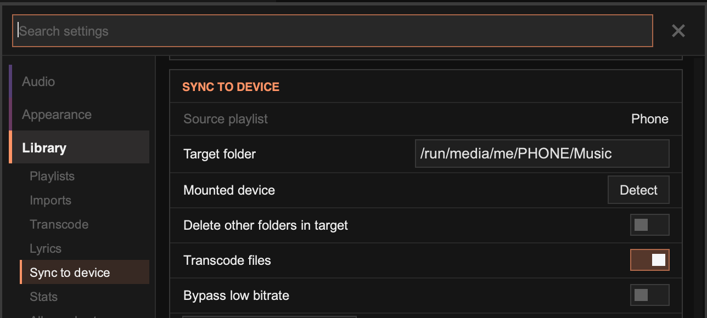

import { Steps } from '@astrojs/starlight/components';

## Transcoding

Transcoding converts audio to a different format, for example FLAC to Opus or MP3, and saves the result in an output folder. This is useful for copying music to devices with limited storage.

:::note
Transcoded albums are saved in a flat structure: `Artist - Album/filename.ext` inside the output folder. The original folder structure isn't kept.
:::

<Steps>
1. Choose the **Codec** and **Bitrate** in **Settings › Library › Transcode**.

     :::tip
     Opus at around 72 kbps gives very small files that still sound good. Turn on **Save opus as .ogg** for better compatibility with Android players.
     :::

2. Right-click any track of an album and choose **Transcode Folder**. The whole album is transcoded. Progress is shown by the activity indicator at the top right.
</Steps>

Press `F9` to open the output folder in your file manager.

Other ways to transcode:

- **One track:** hold `Shift` while right-clicking a track and choose **Transcode Single**.
- **A whole playlist:** right-click the playlist tab and choose **Misc… › Transcode All**.

To replace the original files with the transcoded ones, choose **Save and overwrite files in place** in **Settings › Library › Transcode**. Back up your files before using this.

## Sync

Sync keeps a folder on a device, such as a phone or portable player, matching a playlist. Keep a playlist of the albums you want on the device, add and remove albums as you like, and only the differences are copied.

<Steps>
1. **Make a sync playlist.** Create a playlist (for example "Phone") and fill it with the albums you want on the device. Right-click its tab and choose **Misc… › Set as Sync Playlist**.

     :::tip[Gallery Quick Add]
     To build the playlist quickly, right-click its tab and choose **Misc… › Engage Gallery Quick Add**. Now right-click any album in the [gallery](/manual/gallery/), in any playlist, to add it to or remove it from the sync playlist. When you're done, choose **Disengage Quick Add** from the main menu.
     :::

2. **Connect the device.** Its storage must be mounted, with a folder to sync music into.

3. **Set up sync** in **Settings › Library › Sync to device**:
    - Enter the **Target folder**, or click **Detect** to find a mounted device automatically.
    - Turn on **Transcode files** to convert music using your transcode settings, or turn it off to copy the files unchanged. **Bypass low bitrate** copies low-bitrate files instead of transcoding them again.
    - **Delete other folders in target** removes any folders on the device that aren't in the playlist.

4. Click **Start Transcode and Sync** (or **Start Sync** when not transcoding).
</Steps>

You can stop the sync at any time with **Stop**, or from the activity indicator at the top right. Starting again picks up where it left off.

### Device notes

- **Android:** connect by USB and open the phone in your file manager to mount it, then try **Detect**. If that doesn't work, enter the path by hand.
- **iPhone:** install a player that accepts files, such as [foobar2000](https://apps.apple.com/us/app/foobar2000/id1072807669). Connect by USB and mount the app's documents in your file manager. On GNOME the path looks like `/run/user/1000/gvfs/afc:host=…/com.foobar2000.mobile`. Paste the full path into **Target folder**.

:::note[Flatpak]
Grant Tauon permission to access the target path if you're using the Flatpak version.
:::

:::tip
Sync matches albums by their folder names. To redo an album, for example after changing the codec or bitrate, delete it from both the output folder and the device, then sync again.
:::
